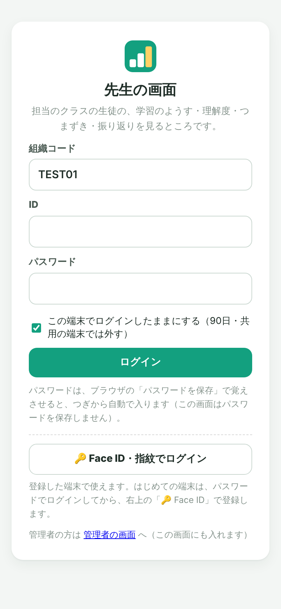
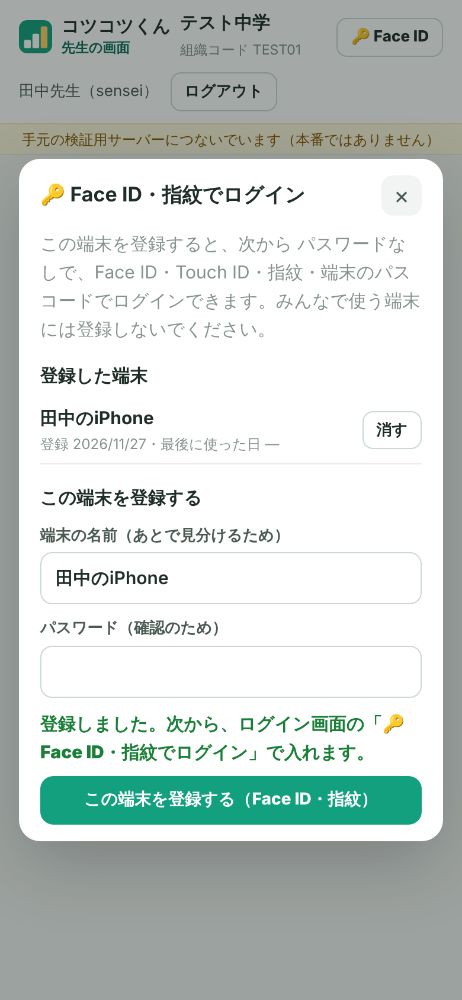

# 先生・管理者の「Face ID・指紋でログイン」（パスキー）

先生の画面（`solo/teacher/`）・管理者の画面（`solo/admin/`）に、パスワードを使わずに Face ID・Touch ID・指紋・端末のパスコードでログインできるしくみ（WebAuthn のパスキー）を足した。**生徒は使えない**（先生と管理者だけ）。

## 状況（2026-11-27）

| 段階 | 状況 |
|---|---|
| 作る | データベースの表と関数（`sql/kotsu_passkeys.sql`）・署名を確かめる Edge Function（`function/passkey/`）・画面の部品（`web/pk.js`）とパッチ（`web/patch_pk.py.txt`） |
| 確かめる | 本番と同じ関数を手元の Postgres に入れ、Chromium の「仮想の認証器」（Face ID の代わり）で本物の登録・ログインを通した：`test/test_pk.log` 24件 PASS。署名の確かめの単体テスト（ECDSA・RSA・ちがうオリジン・本人確認なし など）：`test/unit_webauthn.log` 9件 PASS |
| **本番に入れる** | **まだ**（先生の確認待ち）。本番のデータベースに表と関数を足し、Edge Function「passkey」を置き、画面を公開する |

## 使い方（先生・管理者）

1. いつものように、パスワードでログインする。
2. 右上の「🔑 Face ID」→ 端末の名前（例「田中のiPhone」）とパスワード（確認のため）を入れて「この端末を登録する」→ Face ID。
3. 次から、ログイン画面の「🔑 Face ID・指紋でログイン」→ Face ID だけで入れる（組織コード・ID・パスワードは要らない）。
4. なくした・使わなくなった端末は、別の端末でログインして「🔑 Face ID」の一覧から「消す」。

- iPhone・iPad・Mac のパスキーは iCloud キーチェーンで同期するので、同じ Apple ID の別の端末でも使える。
- 1人10台まで。みんなで使う端末には登録しない（その端末のパスコードを知っている人が入れてしまうため）。

 

## しくみ

- **登録**：ログイン中の本人が、パスワードをもう一度入れて（`kotsu.pk_reg_begin`）、端末が作った公開鍵（SPKI）を置く（`kotsu.pk_reg_finish`）。`clientDataJSON` の種類・1回かぎりのチャレンジ（5分）・オリジン（`https://dora9991.github.io`）を確かめる。秘密鍵は端末から出ない。
- **ログイン**：`kotsu.pk_login_begin` がチャレンジ（3分・1回かぎり）を出し、端末が Face ID のあとで署名する。Edge Function `passkey` が、オリジン・rpId（`dora9991.github.io`）・本人確認（UV）・署名（ECDSA P-256 / RSA）を確かめてから、`kotsu.pk_login_finish`（service_role だけが呼べる）でチャレンジを使い切り、パスワードのときと同じ形のログイン（30日のトークン）を返す。
- **止める**：止めた人・止めた組織・生徒は入れない。人を消すと、かぎも消える。ログイン・登録・削除は `kotsu.audit` に残る（`login_passkey`・`passkey_add`・`passkey_del`）。
- 画面は、`kanri`（共通のログイン部品）を変えずに、先生・管理者の画面のファイルだけを差しかえる（ログイン画面の下と、右上に部品を足す）。

## 本番に入れる手順（確認のあと）

1. `sql/kotsu_passkeys.sql` を本番に適用する（表 `kotsu.passkeys`・`kotsu.passkey_challenges`、関数 `kotsu.pk_*`。`service_role` に `kotsu` スキーマの USAGE と、`pk_get`・`pk_login_finish` の実行権を足す）。
2. Edge Function `passkey`（`index.ts`・`webauthn.js`、verify_jwt なし）を置く。
3. 本番で、`pk_login_begin` と Edge Function が答えることを確かめる。
4. `python3 web/patch_pk.py.txt <公開中の assets> web/pk.js <出力>` → `pk-*.js`・`teacher-*.js`・`admin-*.js` を gh-pages に置き、`solo/teacher/index.html`・`solo/admin/index.html` の読みこみを差しかえる。
