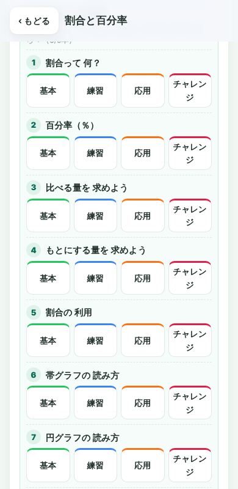
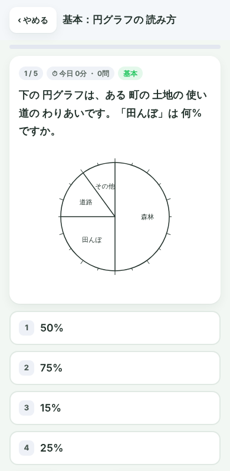

# コツコツくん 小5「解説ごとの演習」（75本・1,500問）

小1〜小4・中1〜高3と同じ形（解説1本につき、4段階（基本・練習・応用・チャレンジ）× 5問、4択）の演習を、ホー先生の小5の全75本につくった。

## 状況（2026-11-27）

| 段階 | 状況 |
|---|---|
| 作る | 8人で分担（`SPEC.md` の決めごと）。授業の台本（`summary`・`script`）から範囲を読み、python（Decimal・Fraction）で正解を計算して書き出した。機械検査（`tools/check_e5.mjs`：形・選択肢4つ・正解1つ・5年までの漢字・図の形）エラー 0。各担当の検算スクリプトは `verify/` |
| 解き直す | 正解を伏せた別の8人が全問を解き直した（`resolution.md`）。食い違い・「問題あり」はすべて計算で判定し、あいまいな問題は書き直した |
| 本体に入れる | 公開用のファイル（`chunks/`）と、公開中の solo バンドル（`solo-rj05De9t.js`、小4まで入ったもの）に足すパッチ（`tools/patch_e5.py.txt`）を作った |
| 確かめる | 公開中のバンドル＋パッチで、小5の14単元すべてに「📺 解説ごとの演習」が出る／75本すべてが出る／16本（各分野1本）を5問解いて結果の画面まで／コンソールのエラーなし（`tools/test_e5.log`）。小3・小4のテストも、同じバンドルで通る |
| **公開** | **まだ**（先生の「公開して」を待つ） |

## 中身

| 担当 | 範囲 | 授業 | 問題 | 公開用ファイル | アプリの単元 |
|---|---|---|---|---|---|
| e5a | 整数と 小数（4）・体積（5） | 9 | 180 | e5tai | E4-shosu・E5-taiseki |
| e5b | 比例（4）・平均（5） | 9 | 180 | e5heikin | E6-hirei・E5-heikin |
| e5c | 小数の かけ算（5）・わり算（5） | 10 | 200 | e5shosu | E5-shosukake |
| e5d | 倍数と 約数（5）・分数（5） | 10 | 200 | e5bunsu | E5-baisu・E5-bunsu |
| e5e | 分数と 小数・整数（4）・単位量あたりの 大きさ（5） | 9 | 180 | e5tani | E5-bunsu・E5-tani |
| e5f | 割合（5）・帯グラフと 円グラフ（4） | 9 | 180 | e5wariai | E5-wariai |
| e5g | 面積（5）・合同な 図形と 角（5） | 10 | 200 | e5zukei | E5-menseki・E5-godo／E5-kakudo |
| e5h | 円周と 正多角形（5）・角柱と 円柱（4） | 9 | 180 | e5enshu | E5-enshu・E5-kakuchu |

- `data/e5a.json`〜`e5h.json`：1,500問。形は `{ id, u, s, l, d, q, c:[{t, k|w}], e, h, f? }`（`f` は図の SVG）。
- 図：73問。数直線・テープ・ぼうグラフ・ほうがん紙の図形・円、**帯グラフと円グラフ**（小5で新しく足した図。帯グラフは10％ごと、円グラフは5％ごとのめもりで読む）。
- `chunks/`：公開用ファイル8つと索引 `lessons.json`、パッチ後の solo（`solo-1Q0-Qcx6.js`）。
- `tools/`：作る手順（`AUTHOR.md`）・解き直しの手順（`SOLVER.md`）・図の道具（`figs.py`）・検査・照合・パッチ・テスト。
- `answers/`：解き直しの答えと、答え合わせ用のキー（`pass1/` は選択肢を混ぜる前の1回目）。

## 注意

- **アプリの単元の置き方**：「整数と 小数」の4本は、アプリでは小4の「小数」の単元（E4-shosu）に、「比例」の4本は小6の「比例と反比例」の単元（E6-hirei）に属している（授業の索引のとおり）。そのため、その単元のページに出る。
- **漢字**：5年までの漢字だけ。6年の漢字は、ひらがなにした（四捨五入 →「四しゃ五入」（授業の台本と同じ書き方）、歩合の「割」→「わり」など）。算数の言葉の「展」「頂」「垂」「密」「偶」「奇」「縦」は使う。
- **比例**：授業の台本が「○＝決まった数×□」の式を教えるので、hirei5-02・hirei5-04 にはその式の問題がある（y・x の文字は使わない）。
- 選択肢の順は、アプリが毎回まぜて出す（作った側の正解の位置の並びは、生徒には見えない）。
- 本体に入れるときは、ほかの学年と同じ（解説の索引 `Wn` と、読みこみの表 `./<キー>.json` に足す）。次に本体から公開すると、この2か所は元にもどるので、本体のソースにも入れること。
- 公開の手順：`node tools/build-chunks_e5.mjs <出力>` → `python3 tools/patch_e5.py.txt <公開中の solo-*.js> <出力> <新しい solo-*.js>`（anchor が1回ずつ出ることを assert する）→ 新しい名前（sha256 の先頭8字）にして、`solo/index.html` の参照を差し替える → gh-pages に push。

 
