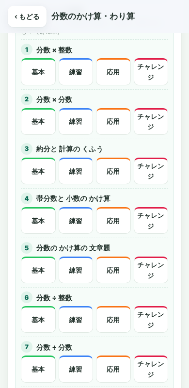
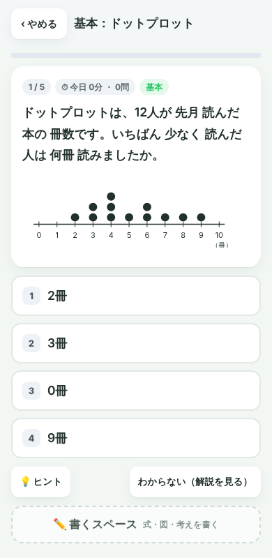

# コツコツくん 小6「解説ごとの演習」（56本・1,120問）

小1〜小5・中1〜高3と同じ形（解説1本につき、4段階（基本・練習・応用・チャレンジ）× 5問、4択）の演習を、ホー先生の小6の全56本につくった。**これで、解説の授業は小1〜高3の912本すべてに演習がそろう**（2026-11-27 に小5・小6を公開し、すべて公開済み）。

## 状況（2026-11-27）

| 段階 | 状況 |
|---|---|
| 作る | 6人で分担（`SPEC.md` の決めごと）。授業の台本（`summary`・`script`）から範囲を読み、python（Fraction・Decimal・itertools・statistics）で正解を計算して書き出した。正解の位置は、作る段階で乱数にした |
| 検査 | `tools/check_e6.mjs`（形・選択肢4つ・正解1つ・6年までの漢字・図の形）エラー 0。今回足した検査：`tools/anscheck.cjs`（解説のさいごの「こたえ」と正解の選択肢の文が合うか）・`tools/polycheck.cjs`（図の多角形が、ねじれていないか） |
| 解き直す | 正解を伏せた別の6人が、選択肢の順を問題ごとに混ぜた版で全問を解き直した（`resolution.md`）。食い違い・「問題あり」はすべて判定し、直した |
| 本体に入れる | 公開用のファイル（`chunks/`）と、パッチ（`tools/patch_e6.py.txt`）。**土台は小5の入ったバンドル**（`docs/kotsu-sho5/chunks/solo-1Q0-Qcx6.js`） |
| 確かめる | 小5＋小6を入れたバンドルで、小6の10単元すべてに「📺 解説ごとの演習」が出る／56本すべてが出る／12本を5問解いて結果の画面まで／コンソールのエラーなし（`tools/test_e6.log`）。小5・小4のテストも、同じバンドルで通る |
| 公開 | 2026-11-27、小5と一緒に gh-pages へ（`0f196b5`、solo-xogIQ8Cz.js） |

## 中身

| 担当 | 範囲 | 授業 | 問題 | 公開用ファイル | アプリの単元 |
|---|---|---|---|---|---|
| e6a | 対称な 図形（5）・文字と 式（5） | 10 | 200 | e6moji | E6-taisho・E6-moji |
| e6b | 分数の かけ算（5）・わり算（5） | 10 | 200 | e6bunsu | E6-bunsukake |
| e6c | 比（5）・拡大図と 縮図（5） | 10 | 200 | e6hi | E6-hi・E6-kakudai |
| e6d | 円の 面積（6）・角柱と 円柱の 体積（5） | 11 | 220 | e6en | E6-enmenseki・E6-kakuchu |
| e6e | 比例と 反比例（5）・場合の 数（5） | 10 | 200 | e6hirei | E6-hirei・E6-baai |
| e6f | データの 調べ方（5） | 5 | 100 | e6data | E6-data |

- `data/e6a.json`〜`e6f.json`：1,120問。形は `{ id, u, s, l, d, q, c:[{t, k|w}], e, h, f? }`。
- 図：92問。小6で新しく足した図の道具（`tools/figs.py`）：
  - `poly2`：ほうがん紙の図形に、対称の軸（点線）・対称の中心（点）・ちょう点の記号
  - `xygraph`：比例の直線・反比例の曲線（方眼つき）
  - `dotplot`：ドットプロット
  - `hist`：柱状グラフ
- `chunks/`：公開用ファイル6つと索引 `lessons.json`、パッチ後の solo（`solo-xogIQ8Cz.js`、小5＋小6入り）。

## 注意

- **漢字**：小学校で習う漢字（1〜6年）だけ。算数の言葉の「称」（線対称）・「頻」（最頻値）・「偶」「奇」は使う。「軸」「範」は小学校の漢字でないので「じく」「はんい」。
- **文字と式**：式は `x × 4` のように × を書く。ただし授業の台本が「80x と書く」を教えるので、moji-01 に、× をはぶく書き方を問う問題が1問ある。
- **約分**：「約分して」「いちばん かんたんな 整数の 比で」と問題文に書いた問題だけ、約分していない形（6/9・6:9 など）をまちがいの選択肢に入れている（約分のしわすれを確かめる問題）。
- 「比例」の単元（E6-hirei）のページには、小5の「比例」4本と、小6の「比例と反比例」5本の両方が出る。
- 公開の手順：`node tools/build-chunks_e6.mjs <出力>` → `python3 tools/patch_e6.py.txt <小5の入った solo-*.js> <出力> <新しい solo-*.js>` → 新しい名前（sha256 の先頭8字）にして、`solo/index.html` の参照を差し替える → 小5（`docs/kotsu-sho5/chunks/e5*.js`）と小6の公開用ファイル、新しい solo を gh-pages に push。

 
