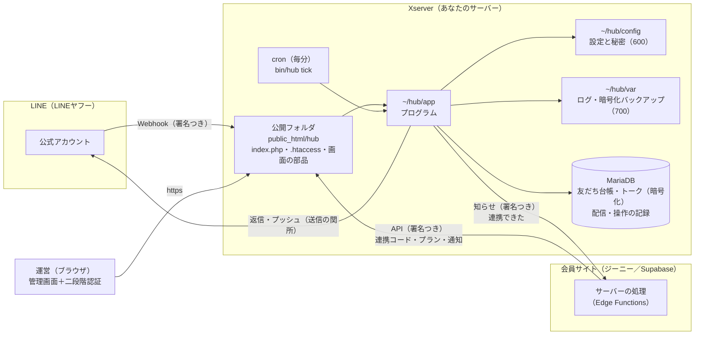
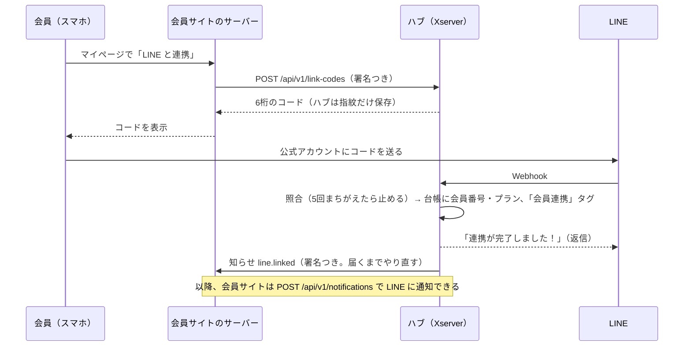

# 01 全体像

## 一枚の絵

- Web から見えるのは `index.php` と画面の部品（js・css）だけです。`.htaccess` で、ほかのファイルは開けないようにしています。
- プログラム・設定・秘密・ログ・バックアップは、公開フォルダの **外**（`~/hub`）に置きます。`index.php` は、置くときに `~/hub` の場所を書き込まれます。
- サブドメインのフォルダは本体のドメインの `public_html` の中にあるので、本体のドメインから開かれないよう、ハブは「ホスト名が違うリクエスト」を断ります（421）。

## データの流れ

### 受け取る（LINE → ハブ）

1. LINE が `https://hub.example.com/webhook/line` へ送る
2. ハブが **署名を確かめる**（チャネルシークレット）。合わなければ断る（続くとメールで知らせる）
3. イベントを、**中身を暗号化して** 記録し、すぐに 200 を返す（LINE を待たせない）
4. 返したあとで処理する：友だち台帳・ルール・ステップ配信の開始・連携コードの照合・チャットの未読
   - 同じイベントが再送されても、二重には処理しません（イベントの ID で見分ける）
   - 処理が途中で失敗したイベントは、毎分の処理がやり直します

### 送る（ハブ → LINE）

**すべての送信は「送信の関所」（`line_outbox`）を通ります。** ここで次を守ります。

- 停止スイッチ（設定 `enabled`／コマンド `line:stop`）
- 練習モード（`dry_run`：送らずに「送るはずだった」記録だけ）
- 月間の通数上限（`monthly_cap`）と、会員通知のための取り置き（`notification_reserve`）
- LINE の混雑（429）・一時的な失敗（5xx）は、間をあけてやり直す。やり直しても二重に届かないよう、LINE の再送キー（`X-Line-Retry-Key`）を使う
- 優先度（小さいほど先）：会員への通知（10）→ 運営への知らせ（20）→ チャット（30）→ ルールの返信・テスト送信（50）→ ステップ配信・一斉配信（100）

返信（リプライ）は通数を使わないので、使えるときは返信で送ります（チャットの画面に「通数は使っていません」と出ます）。

### 会員サイトとつなぐ

LINE の userId は、会員サイトには返しません（会員サイトは「会員番号」だけで話す）。

## 毎分の処理（cron：`bin/hub tick`）

| 順 | やること |
|---|---|
| 1 | 失敗した Webhook イベントのやり直し |
| 2 | Zoom の出欠の確定 |
| 3 | ステップ配信：時刻が来た人の分を、送信の関所に積む |
| 4 | 一斉配信：予約の時刻が来たものを始める／続きを積む |
| 5 | 送信の関所：積まれたものを、上限・優先度を守って送る |
| 6 | 会員サイトへの知らせ（届くまで、間をあけて10回まで） |
| 7 | 保存期間を過ぎたトーク・記録の片づけ |
| 8 | 1日1回の仕事（日本時間）：3時 バックアップ／4時 片づけ／7時 毎日の報告メール |

同じ処理が重ならないよう、DB の「貸出（リース）」で守っています。メンテナンス中は止まります。

## line-hub との関係

| | line-hub（もと） | xserver-hub（これ） |
|---|---|---|
| 言語・DB | Node.js・Postgres | PHP 8.1 以上・MariaDB 10.5 以上 |
| 動かし方 | 常駐プロセス | Webhook を受けたとき＋毎分の cron |
| 管理画面 | `line-hub-admin.js` | **同じファイル**（変更なし） |
| 操作（RPC） | 約65種類 | 同じ名前・同じ入力・同じ権限 |
| 表 | `line_*` | 同じ名前・同じ列（型だけ MariaDB 用に） |
| 行の守り | 行レベルセキュリティ（RLS） | DB のユーザーをハブ専用に＋暗号化＋管理画面の権限 |
| 会員連携 | 会員サイトと同じ DB（genie アダプター） | 別のサーバーどうし。署名つき API（SiteAdapter） |

## どこに何が書いてあるか（プログラム）

| フォルダ | 中身 |
|---|---|
| `app/src/Kernel` | 土台：設定・DB・暗号・パスワード・二段階認証・操作の記録・回数制限・メール・HTTP |
| `app/src/Line` | 配信エンジン：Webhook・送信の関所・ルール・ステップ配信・一斉配信・チャット・アンケート・イベント・Zoom・動画・管理画面の RPC |
| `app/src/Member` | 会員連携：署名つき API・連携コード・会員サイトへの知らせ |
| `app/src/Web` | 管理画面：ログイン・二段階認証・セッション・振り分け |
| `app/src/Ops` | 運用：バックアップ・健康診断・毎日の仕事・本人の情報・鍵の入れ替え・取り込み |
| `app/src/Cli` | コマンド（`bin/hub help` で一覧） |
