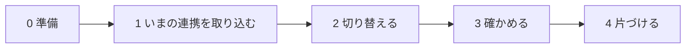

# 06 会員サイト連携 API

会員サイト（ジーニー：Supabase）とハブ（Xserver）は、別々のサーバーです。**サーバー同士が、署名をつけて話します。**

- 会員サイト → ハブ：連携コードを作る・会員のプランを伝える・会員への通知を LINE で送る・連携の解除・退会
- ハブ → 会員サイト：「LINE と連携できた」の知らせ（任意）
- 会員サイトは **会員番号（member_ref）** だけで話します。**LINE の userId は会員サイトに返しません**
- 秘密は会員サイトの **サーバーの中だけ**（Supabase なら Edge Functions の Secrets）。ブラウザ・アプリには絶対に入れない

## ハブ側の設定

`~/hub/config/config.php` の `member`：

```php
'member' => [
    'enabled' => true,
    'site_url' => 'https://member.example.com',          // 通知のリンクの頭
    'api_keys' => [
        // 名前（site）は X-Hub-Key で送る。秘密は hub keys:generate で作る
        'site' => [
            'secret' => '（keys:generate の結果）',
            'scopes' => ['link', 'members', 'notify'],   // 使える範囲
            'allow_ips' => [],                           // 呼び出し元の IP（空なら制限なし）
            // 'rate_per_min' => 600,                    // 1分あたりの上限（既定 600）
            // 'disabled' => true,                       // 一時的に止める（鍵の入れ替えのとき）
        ],
    ],
    'webhook_url' => 'https://xxxx.supabase.co/functions/v1/hub-events', // ハブからの知らせの受け口（任意。https のみ）
    'webhook_secret' => '（keys:generate の結果）',
    'link_code_ttl_min' => 30,                           // 連携コードの有効時間（分）
    'link_code_digits' => 6,                             // 6 か 8
    'plans' => [                                         // 管理画面の絞り込みに出るプラン（rank が大きいほど上位）
        ['code' => 'free', 'name' => '無料', 'rank' => 0],
        ['code' => 'guild', 'name' => 'ギルド', 'rank' => 20],
    ],
],
```

管理画面の「設定」：`site_url`（同じもの。こちらが優先）と、`genie_notify_enabled`（会員サイトの通知を LINE へ。**切り替えが済むまでオフ**）。

---

## 署名の決まり

すべての呼び出しに、次のヘッダーを付けます。

| ヘッダー | 中身 |
|---|---|
| `X-Hub-Key` | 鍵の名前（上の例では `site`） |
| `X-Hub-Timestamp` | いまの UNIX 時刻（秒）。ハブの時計と **5分** 以上ずれていたら断る |
| `X-Hub-Nonce` | 毎回ちがう文字（英数字と `_` `-` で16〜64文字）。**同じものは二度と通らない**（盗み聞きした呼び出しの使い回しを防ぐ） |
| `X-Hub-Signature` | `v1=` ＋ HMAC-SHA256(秘密, 署名する文字) の16進 |
| `Content-Type` | 本文があるときは `application/json` |

署名する文字（改行 `\n` でつなぐ）：

```
v1
{METHOD（大文字）}
{PATH（/api/v1/... 。? 以降は付けない）}
{X-Hub-Timestamp}
{X-Hub-Nonce}
{本文の SHA-256 の16進（本文が無ければ空文字の SHA-256）}
```

自分で書かなくても、見本（`clients/`）がそのまま使えます。

### 応答の形

成功：`{ "ok": true, … }`　失敗：`{ "ok": false, "error": { "code": "…", "message": "日本語の説明" } }`

| HTTP | code | 意味 | どうする |
|---|---|---|---|
| 400 | `bad_request` | 入力の誤り | message を読んで直す（やり直しても同じ） |
| 401 | `unauthenticated` | 署名・時刻・nonce・鍵の誤り | 秘密・サーバーの時計を確かめる |
| 403 | `forbidden` | その鍵に権限（scope）が無い・許していない IP | 設定を確かめる |
| 404 | `not_found` | 道が無い／`member.enabled` がオフ | |
| 409 | `disabled` | 通知→LINE がまだオフ（`genie_notify_enabled`） | 切り替えの手順を済ませる |
| 409 | `in_progress` | 同じ会員への通知を受け付けている最中 | 少し待って、**同じ idempotency_key** でやり直す |
| 429 | `rate_limited` | 呼び出しが多すぎる | 少し待ってやり直す |
| 500 | `internal` | ハブの中の失敗 | やり直す。続くならハブのログ |

---

## API

`member_ref` は会員サイトの会員番号（半角の英数字と `_` `.` `:` `@` `-` で100文字まで。Supabase の `profiles.id`（UUID）がそのまま使える）。

### POST /api/v1/link-codes　連携コードを作る（scope: link）

会員がマイページで「LINE と連携」を押したときに呼び、返ってきたコードを会員に見せます。

```json
// 送る
{ "member_ref": "8f0c…", "plan": "guild", "rank": 20 }
// 返る
{ "ok": true, "code": "482913", "expires_at": "2026-10-15T12:30:00.000Z", "digits": 6 }
```

- 会員は、そのコードを公式アカウントに送るだけ（全角の数字でも通る）。ハブが照合して、台帳に会員番号・プランを入れ、「会員連携」タグを付け、「連携が完了しました！」と返事をします
- 同じ会員の、まだ使っていない古いコードは使えなくなります（いちばん新しいコードだけ有効）
- ハブはコードそのものを保存しません（指紋だけ）。使い捨て・期限つき
- 同じ LINE の人が1時間に5回まちがえると、しばらく受け付けません。全体で1時間に50回まちがいがあると、運営にメール
- すでに別の会員につながっている LINE は、「連携を解除してから」と返事をします
- `plan`・`rank` は任意（送れば、その会員の情報として覚える）

### GET /api/v1/members/{member_ref}　連携の状態（scope: members）

```json
{ "ok": true, "member_ref": "8f0c…", "known": true, "linked": true,
  "line_status": "active", "linked_at": "2026-10-15T03:12:45.100Z", "plan": "guild", "rank": 20 }
```

`line_status`：`active`（友だち）／`blocked`（ブロック中）／`null`（つながっていない）

### PUT /api/v1/members/{member_ref}　会員の情報を入れる・変える（scope: members）

プランが変わったとき・プロフィールの項目が変わったときに呼びます。**送ったものだけ** 変わります。

```json
{ "plan": "seller", "rank": 30, "fields": { "school": "中学校", "area": "九州" } }
```

- `fields`：30項目まで。名前は40文字まで（文字・数字・`_` `.` `-`）、値は200文字までの文字か数字
- つながっている友だちには、すぐ反映されます。`fields` は友だち情報の `member.名前` として、管理画面の一斉配信の絞り込みに使えます（例：`member.school` が「中学校」の人だけ）
- **`fields` に、人に知られたくない情報（病気・家庭の事情など）を入れない**（暗号化していない。絞り込みのため）

### DELETE /api/v1/members/{member_ref}/link　連携を外す（scope: link）

マイページの「LINE 連携を解除」。台帳から会員番号・プラン・`member.*` の項目を外し、「会員連携」タグを外します（LINE の友だちのまま）。→ `{ "ok": true, "unlinked": true }`

### DELETE /api/v1/members/{member_ref}　退会（scope: members）

連携を外し、ハブにある会員の情報（プラン・項目）を消します。→ `{ "ok": true, "deleted": true, "unlinked": true }`

### POST /api/v1/notifications　会員への通知を LINE で送る（scope: notify）

```json
{
  "member_ref": "8f0c…",
  "title": "新しいコメントがあります",
  "body": "「数学の授業」に返信がありました",
  "link": "/posts/42",
  "idempotency_key": "notif-5b1e…"
}
```

LINE には次のように届きます（`link` が `/` で始まるときは、`site_url` をつなげる）：

```
新しいコメントがあります
「数学の授業」に返信がありました
https://member.example.com/posts/42
```

| 項目 | 決まり |
|---|---|
| `title` | 必須。200文字まで |
| `body` | 任意。4000文字まで |
| `link` | 任意。`/` で始まるサイト内の場所か、`https://` の URL（500文字まで） |
| `idempotency_key` | 必須。**通知ごとに決まった値**（例：`notif-` ＋ 通知の id）。英数字と `_` `.` `:` `-` で8〜100文字。同じ値は二度と送らない |

返事：

| 返事 | 意味 |
|---|---|
| `{ "delivered": true, "queued": true }` | 送信の関所に積んだ（優先度10。販促より先、毎分の処理で送る） |
| `{ "delivered": true, "duplicate": true, "status": "sent" }` | 同じ idempotency_key は受け付け済み（二重には送らない） |
| `{ "delivered": false, "reason": "not_linked" }` | その会員は LINE とつながっていない |
| `{ "delivered": false, "reason": "blocked" }` | ブロックされている |

- 月間の上限のうち、`notification_reserve` の分は会員への通知のために取ってあります（一斉配信が使い切っても届く）
- 停止スイッチ・練習モードのときは送られません（記録は残る）

---

## ハブからの知らせ（会員サイトの受け口）

`member.webhook_url` を設定すると、ハブは次の知らせを **POST** します（https のみ）。

| ヘッダー | 中身 |
|---|---|
| `X-Hub-Event` | 知らせの種類（いまは `line.linked` だけ） |
| `X-Hub-Timestamp` | 送った時刻（UNIX 秒） |
| `X-Hub-Signature` | `v1=` ＋ HMAC-SHA256(`webhook_secret`, `"{X-Hub-Timestamp}.{本文}"`) の16進 |

```json
{ "id": 7, "event": "line.linked", "payload": { "member_ref": "8f0c…", "linked_at": "2026-10-15T03:12:45.100Z" }, "created_at": "2026-10-15T03:12:45.100Z" }
```

- 受け口は、**届いたままの本文** で署名と時刻（5分以内）を確かめてから、JSON として読む
- 2xx を返すまで、間をあけて（1分・2分・4分…最大6時間）**10回まで** 送り直します。10回届かなければ、運営にメール
- 同じ知らせが2回以上届くことがあります。`id` で二重の処理を防ぐ
- 重い処理はあとに回して、すぐ 2xx を返す（ハブは10秒で待つのをやめる）

---

## 見本（clients/）

| ファイル | 使うところ |
|---|---|
| [`clients/js/hub-client.mjs`](../clients/js/hub-client.mjs) | Supabase Edge Functions（Deno）・Node.js 18 以上・Cloudflare Workers。`fetch` と `crypto.subtle` だけ |
| [`clients/php/HubClient.php`](../clients/php/HubClient.php) | PHP 8.1 以上の会員サイト（同じ Xserver の WordPress など） |

どちらも、ハブのテスト（`tests/ClientsTest.php`）で、ハブと同じ署名になることを確かめています。

### 例：Supabase Edge Functions

`clients/js/hub-client.mjs` を `supabase/functions/_shared/` にコピーして使います。秘密は `supabase secrets set HUB_URL=https://hub.example.com HUB_API_SECRET=… HUB_WEBHOOK_SECRET=…`。

**① 連携コードを出す**（マイページのボタンから、ログイン中の会員が呼ぶ）

```ts
// supabase/functions/hub-link-code/index.ts
import { createClient } from 'npm:@supabase/supabase-js@2';
import { createHubClient } from '../_shared/hub-client.mjs';

const hub = createHubClient({ baseUrl: Deno.env.get('HUB_URL')!, keyId: 'site', secret: Deno.env.get('HUB_API_SECRET')! });
const cors = { 'Access-Control-Allow-Origin': 'https://member.example.com', 'Access-Control-Allow-Headers': 'authorization, content-type, apikey, x-client-info' };

Deno.serve(async (req) => {
  if (req.method === 'OPTIONS') return new Response(null, { headers: cors });
  const supabase = createClient(Deno.env.get('SUPABASE_URL')!, Deno.env.get('SUPABASE_ANON_KEY')!, {
    global: { headers: { Authorization: req.headers.get('Authorization') ?? '' } },
  });
  const { data: { user } } = await supabase.auth.getUser();
  if (!user) return new Response('unauthorized', { status: 401, headers: cors });
  const r = await hub.createLinkCode(user.id); // プランも伝えるなら { plan, rank }（会員サイトの決め方で）
  return Response.json({ code: r.code, expires_at: r.expires_at }, { headers: cors });
});
```

**② 通知を LINE へ**（Database Webhook：`notifications` の INSERT → この関数）

```ts
// supabase/functions/hub-notify/index.ts（--no-verify-jwt で公開し、自分の合言葉で守る）
import { createHubClient } from '../_shared/hub-client.mjs';

const hub = createHubClient({ baseUrl: Deno.env.get('HUB_URL')!, keyId: 'site', secret: Deno.env.get('HUB_API_SECRET')! });

Deno.serve(async (req) => {
  // Database Webhook の HTTP Headers に Authorization: Bearer <長い乱数> を設定しておく
  if (req.headers.get('authorization') !== `Bearer ${Deno.env.get('HUB_NOTIFY_HOOK_TOKEN')}`) return new Response('forbidden', { status: 403 });
  const { type, table, record } = await req.json();
  if (type !== 'INSERT' || table !== 'notifications') return new Response('ignored');
  const r = await hub.notify({
    memberRef: record.user_id,
    title: record.title,
    body: record.body ?? undefined,
    link: record.link ?? undefined,
    idempotencyKey: `notif-${record.id}`,
  });
  return Response.json(r);
});
```

**③ ハブからの知らせを受け取る**（`member.webhook_url` に、この関数の URL）

```ts
// supabase/functions/hub-events/index.ts（--no-verify-jwt で公開。署名で守る）
import { verifyHubWebhook } from '../_shared/hub-client.mjs';

Deno.serve(async (req) => {
  const raw = await req.text();
  const ok = await verifyHubWebhook({
    secret: Deno.env.get('HUB_WEBHOOK_SECRET')!,
    timestamp: req.headers.get('x-hub-timestamp') ?? '',
    signature: req.headers.get('x-hub-signature') ?? '',
    body: raw,
  });
  if (!ok) return new Response('bad signature', { status: 401 });
  const ev = JSON.parse(raw);
  if (ev.event === 'line.linked') {
    // 例：マイページに「連携済み」と出すための印を付ける（列は会員サイトに合わせる。ev.id で二重の処理を防ぐ）
  }
  return new Response('ok');
});
```

---

## いまのジーニーからの切り替え

いまは、会員サイト（Supabase）の中で、連携コード（`profiles.line_link_code`）と、LINE の Webhook（`line-webhook` 関数）と、通知→LINE（`trg_line_push` → `line-push` 関数）が動いています。これをハブへ移します。



### 0. 準備（いつでも。会員には見えない）

1. ハブを立ち上げる（[02](02_Xserver初期設定.md)）。**練習モード（`dry_run`）オン**
2. `config.php` の `member` を設定（上の「ハブ側の設定」）。`genie_notify_enabled` は **オフのまま**
3. Edge Functions ①②③ をデプロイし、秘密を設定。この時点では、まだマイページからは呼ばない

### 1. いまの連携を取り込む

Supabase の SQL エディタで、つながっている会員を CSV に書き出します（**このファイルには個人を指す情報が入ります**）。

```sql
select p.id as member_ref,
       p.line_user_id,
       (select m.code from public.membership_plans m where m.rank = public.current_plan_rank(p.id) limit 1) as plan,
       public.current_plan_rank(p.id) as rank
from public.profiles p
where p.line_user_id is not null;
```

```bash
# 自分のパソコンから、ハブの書き出し用フォルダ（700）へ
scp -P 10022 -i ~/.ssh/xs123456.key links.csv xs123456@xs123456.xsrv.jp:hub/var/export/
# ハブで（--check：LINE に1人ずつ問い合わせて、友だちかどうか・表示名を確かめる。1秒に10人）
hub import:links ~/hub/var/export/links.csv --check
rm ~/hub/var/export/links.csv      # 取り込んだら、すぐ消す（パソコンの方も）
```

何度流しても同じ結果になります（切り替えの直前に、もう一度流すと差分も入る）。

### 2. 切り替える（10分ほど。会員の少ない時間に）

1. マイページの「LINE と連携」を、①（`hub-link-code`）を呼ぶように変えて公開する
2. LINE の Webhook をハブへ：`hub line:set-webhook`（ここから、LINE に送られたコードはハブが照合する。切り替えの直前に会員サイトが出した古いコードは使えないので、その人には出し直してもらう）
3. 通知の切り替え（**二重に送らない順番**）：
   1. Supabase で、古いトリガーを外す：`drop trigger if exists trg_line_push on public.notifications;`
   2. Database Webhook（`notifications` の INSERT → ②）を作る
   3. ハブの管理画面「設定」で「会員サイトの通知を LINE へ」（`genie_notify_enabled`）を **オン**
   - 1.〜3. の間に作られた通知は、LINE には届きません（サイトの通知には残る）。なるべく続けて
4. プランが変わる処理（決済の Webhook など）と退会の処理から、`PUT /api/v1/members/{id}`・`DELETE /api/v1/members/{id}` を呼ぶようにする
5. ハブの練習モードをオフ

### 3. 確かめる

- テスト用の会員で：連携コード → LINE に送る → 「連携が完了しました！」→ 管理画面の友だちに会員番号・プラン・「会員連携」タグ
- 会員サイトで通知を1つ作る → LINE に届く（管理画面「送信状況」に `notification`）
- `hub doctor --online`

### 4. 片づける（1〜2週間、落ち着いたら）

使わなくなった秘密と情報を減らします（**持たない情報は、漏れない**）。

- Supabase の `line-webhook`・`line-push` 関数を消す。そこで使っていた LINE のトークン・シークレットを Supabase の Secrets から消す
- 会員サイトが `profiles.line_user_id`・`line_link_code` を使っていないことを確かめてから、空にする（LINE の userId はハブだけが持つ）

### 戻し方（切り替えをやめるとき）

1. LINE Developers コンソールで、Webhook の URL を元（Supabase の `line-webhook`）に戻す
2. ハブの「会員サイトの通知を LINE へ」をオフ → Database Webhook を外す → `trg_line_push` を作り直す
3. マイページの「LINE と連携」を元に戻す
